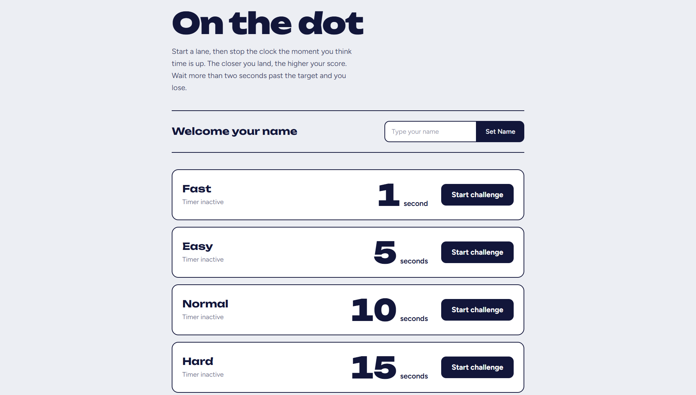

# On the Dot

A reaction-based timing game built with **React** and **Vite**.

Think you have a good sense of time? Start the timer, estimate when the target time is up, and stop it as close to the target as possible. The closer you get, the higher your score!

🔗 **[Live Demo](https://sadra00sa.github.io/Timer-Game/)**

## Preview



## About the Game

On the Dot is a simple but challenging timing game where players test their ability to estimate time without relying on a visible countdown.

Choose a difficulty level, start the challenge, and stop the timer when you think the target time has passed.

Accuracy is everything!

## Game Rules

- Choose one of four difficulty levels.
- Start the timer and try to estimate when the target time is up.
- Stop the timer as close to the target as possible.
- The closer your timing, the higher your score.
- Going more than 2 seconds past the target results in a loss.

## Difficulty Levels

| Level | Target Time |
|---|---:|
| Fast | 1 Second |
| Easy | 5 Seconds |
| Normal | 10 Seconds |
| Hard | 15 Seconds |

## Features

- Four difficulty levels.
- Interactive timer challenges.
- Accuracy-based scoring system.
- Player name input.
- Real-time timer status.
- Simple and clean user interface.

## Built With

- React
- JavaScript
- Vite
- CSS
- HTML

## Getting Started

To run this project locally:

**1. Clone the repository**

```bash
git clone https://github.com/sadra00sa/Timer-Game.git
```

**2. Navigate to the project directory**

```bash
cd Timer-Game
```

**3. Install dependencies**

```bash
npm install
```

**4. Start the development server**

```bash
npm run dev
```

Open the local URL provided by Vite in your browser.

---

**Developed by [Sadra Salehi](https://github.com/sadra00sa)**
